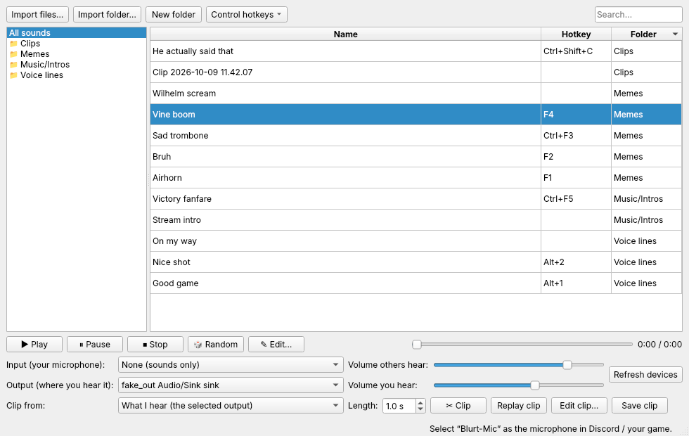
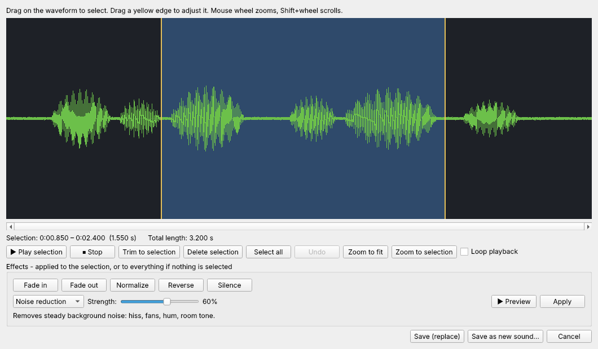

# Blurt

Blurt is a re-implementation of [Soundpad](https://store.steampowered.com/app/629520/Soundpad/) for Linux. Soundpad is Windows only, and there is currently no way to get it working on Linux without a lot of troubleshooting. Blurt does the same job natively: it plays audio files through your microphone so other people hear them in Discord, in game voice chat, or anywhere else that takes a mic.



## What it does

While Blurt is open it creates a virtual microphone called **Blurt-Mic**. Pick that as the input device in your voice app. Others then hear your real microphone plus whatever you play, and you hear the sounds on the output device you choose.

## Features

- **Soundboard:** import audio files (mp3, wav, ogg, opus, flac, m4a and more), play, pause, stop, seek, or play a random one.
- **Hotkeys:** bind any sound to a key or key combination. Stop, pause, random and the clip actions can be bound too. Hotkeys work while a game is focused.
- **Device selection:** choose which microphone feeds the mix and which output you listen on.
- **Separate volumes:** one slider for how loud others hear a sound, one for how loud you hear it.
- **Folders:** import a whole folder tree at once, or create, rename and delete folders inside Blurt. Drag and drop works.
- **Clipping:** Blurt keeps a rolling buffer of what plays on your output. Press a hotkey to clip the last 0.2 to 30 seconds, replay it through the mic, edit it, or save it to your library. Blurt's own playback is left out of the clip.
- **Editor:** a waveform view where you select, trim, cut, zoom and undo, with a preview that only you hear.
- **Effects:** noise reduction, click removal, noise gate, amplify, normalize, fades, reverse, silence, repeat, speed, pitch, echo, reverb, bass boost, distortion, telephone and robot. Each one can be previewed before it is applied.
- **Noise gate:** mutes your mic between words so breaths, typing and background noise are not heard. Toggle it in the main window or with a hotkey, and set the threshold with the live level meter.
- **Voice changer:** change your live mic voice. Includes a B1 Battle Droid voice, and AI voices from any RVC model you download (for example Miku or Teto). Record a test (5 to 30 seconds) to hear the result privately before anyone else hears it, or turn on "Hear myself live".
- **Refresh:** press **Refresh** (or F5) to pick up new audio files without restarting: files copied into Blurt's sounds folder, and new files in folders you imported. Blurt also checks whenever you switch back to its window.
- **Real files:** your library is stored as normal files in `~/.local/share/blurt/sounds/`, in folders that match the ones in the app.



## Requirements

- Linux with PipeWire (with `pipewire-pulse`) or PulseAudio
- `curl` or `wget` (the installer downloads its own Python, so the system Python is not needed)
- `pactl` and `parec` (part of `libpulse` or `pulseaudio-utils`)
- `pw-dump` and `pw-link` (part of PipeWire) to keep Blurt's own playback out of clips
- For AI voices only: about 1 GB for PyTorch, plus a one time 560 MB download of two helper files. A recent multi-core CPU is needed for live AI voices.

SteamOS already ships all of these.

## Install

```bash
git clone https://github.com/Daggenthal/blurt.git
cd blurt
bash install.sh
```

The installer needs no root. It puts everything in your home folder: its own Python (via [uv](https://github.com/astral-sh/uv)) with PySide6 and numpy in `~/.local/share/blurt/`, a launcher in `~/.local/bin/blurt`, and a menu entry. Because Blurt brings its own Python, SteamOS updates (including beta branches) cannot break it by changing the system Python. If anything ever does break, starting Blurt offers to repair itself.

To also enable AI voices, run the installer with `--ai-voice` instead:

```bash
bash install.sh --ai-voice
```

For hotkeys that work while another window is focused, add yourself to the `input` group once, then log out and back in:

```bash
sudo usermod -aG input $USER
```

On SteamOS you need to set a password with `passwd` first. Without this step, hotkeys only work while the Blurt window is focused.

To update, pull the latest version and run `bash install.sh` again. Your sounds, folders and hotkeys are kept.

## Run

Start **Blurt** from your application menu, or run:

```bash
~/.local/bin/blurt
```

Then:

1. Select **Blurt-Mic** as the microphone in Discord or your game.
2. In Blurt, pick your real microphone under Input and your headphones or speakers under Output.
3. Import some sounds, right-click one and choose **Set hotkey**.

## Voice changer

Click **Voice** in the main window.

- **B1 Battle Droid** works right away. Pitch, size and metal can be adjusted. Any voice, this one included, can be removed with **Remove**, or several at once with **Manage voices**.
- **AI voices** use RVC voice models (a `.pth` file, ideally with its `.index` file). Click **Find voices online** to search Hugging Face and add one in a click, or **Add from file** for a `.pth` or `.zip` you already have. Blurt does not include any models. Downloaded voices are kept in `~/.local/share/blurt/voices/`.
- **Loudness:** each voice has an output boost, and "Even out loudness" brings quiet voice models up to a normal talking level, with a soft limiter so it never clips.
- **Saved settings:** each voice remembers its own settings. **Save settings as** keeps named versions (for example "talking" and "singing"), with a backup next to the model file, so they come back even if the voice is removed and added again.
- **Automatic settings:** after your first test recording, Blurt measures your voice and sets the pitch shift for the kind of voice you picked (high, medium or low). It also measures how fast your computer runs the voice and picks the live responsiveness.
- **Test first:** press **Record test**, speak, then press **Play with voice** to hear the result (only you hear it).
- **Go live:** tick **Others hear this voice** to send it to Blurt-Mic. A hotkey can toggle it.

If the live AI voice skips, **Performance details** in the Voice window shows which step takes the time (speech features, index search, pitch tracking or the model itself), along with CPU speed, system load and model details. It can copy or save a report, and also writes one to `~/.local/share/blurt/voice-performance.log` every 15 seconds.

AI voices run on the CPU by default. Newer CPUs with AVX-512 BF16 (for example Ryzen 7000 and later) use a faster maths mode automatically. Live AI voices have roughly half a second to a second of delay, depending on your hardware and the responsiveness setting.

For much faster AI voices on an AMD graphics card, install the ROCm build instead (a download of several GB):

```bash
bash install.sh --ai-voice-gpu
```

Then tick **Use the graphics card** in the Voice window. This has not been tested on the Steam Machine's GPU yet; if it does not work, Blurt falls back to the CPU. Blurt loads `.pth` files in PyTorch's safe mode, which refuses files that contain code.

## Tested on

A Steam Machine running SteamOS with the default KDE Plasma desktop. Other distributions with PipeWire should work but have not been tested.

## Notes

- Hotkeys are observed, not captured, so the key press still reaches the game. Bind keys the game does not use.
- The virtual microphone only exists while Blurt is running.
- Sounds saved from the editor are stored as WAV.

## License

[MIT](LICENSE)
